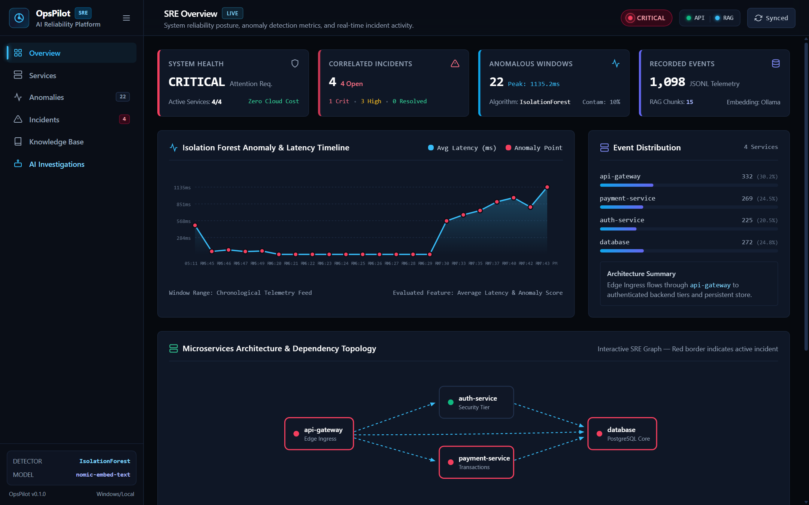
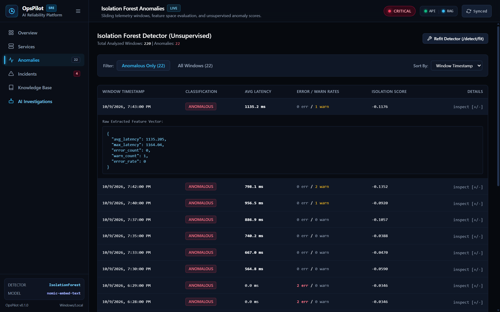
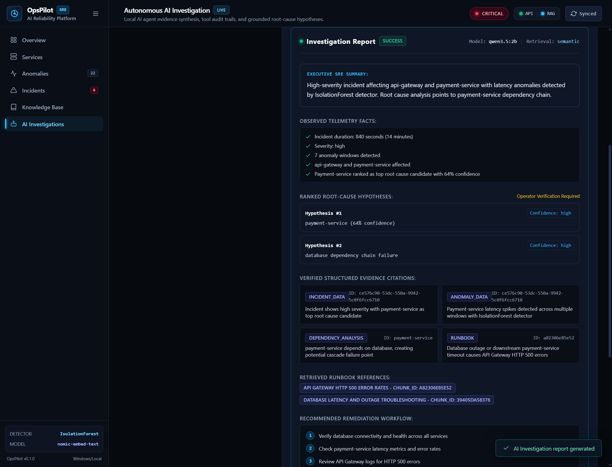
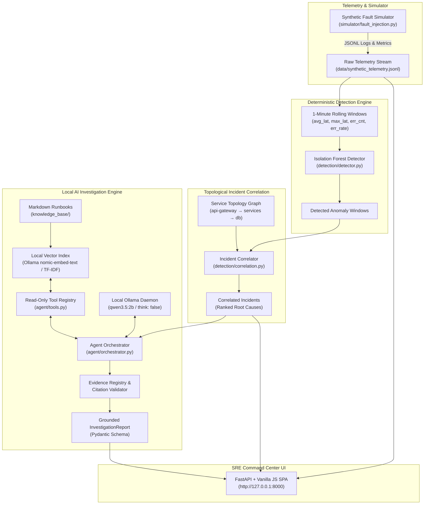

# OpsPilot: AI Site Reliability Engineering & Incident Intelligence Platform

OpsPilot is a local-first, zero-cost AI Site Reliability Engineering (SRE) command center. It unifies unsupervised anomaly detection, topological incident correlation, local vector retrieval-augmented generation (RAG), and a sandboxed, tool-calling local AI agent to investigate microservice incidents—operating entirely on commodity consumer hardware with **₹0 in software, API, or infrastructure costs**.

---

## Visual Tour

### 1. SRE Command Center Overview
Real-time fleet telemetry, active incident status, service dependency health, and vector index status.


### 2. Unsupervised Anomaly Explorer
Isolation Forest detector analyzing rolling 1-minute telemetry windows (latency, error volume, error rate) without relying on ground-truth labels.


### 3. Grounded AI Incident Investigation
Local SLM (`qwen3.5:2b`) executing approved read-only tools, gathering structured evidence, citing verified tool provenance, and ranking root causes against curated runbooks.


---

## Key Highlights & Architectural Principles

- **Zero Cloud Spend (₹0 Budget)**: Runs entirely on local commodity hardware (Intel Core i7, 16 GB RAM). No OpenAI, Anthropic, Datadog, or cloud GPU dependencies.
- **Independent Anomaly Detection**: Anomaly detection and topological root-cause correlation operate 100% deterministically without relying on the LLM.
- **Read-Only Sandboxed Agent**: The AI investigator operates strictly within a hardened tool registry (`get_incident`, `get_incident_anomalies`, `get_metric_summary`, `search_knowledge`, `get_service_dependencies`). Zero shell, database, or arbitrary network access.
- **Strict Evidence Citation & Provenance**: The agent must validate every citation against structured tool output registries. Fabricated or unlinked claims are rejected.
- **Deterministic Offline Fallbacks**: If Ollama is offline or unavailable during CI/CD or headless testing, RAG gracefully falls back to TF-IDF search, and investigations return transparent, schema-validated status reports without crashing or faking data.
- **Full Test Coverage**: 44 automated pytest tests covering security, anomaly detection, correlation, RAG retrieval, tool execution, and end-to-end API workflows.

---

## System Architecture



---

## Measured Evaluation & Benchmark Results

All evaluation benchmarks were run locally and measured on an Intel Core i7-1255U (16 GB RAM) host.

### 1. Anomaly Detection (1-Minute Rolling Windows)

Evaluated against 1,098 synthetic events spanning injected fault scenarios (`db_outage`, `db_slowdown`, `http_error_spike`, `slow_responses`). Ground-truth labels are excluded from detector features.

| Detector | Precision | Recall | F1 Score | False Positive Rate (per 1,000 normal windows) | Overhead |
| :--- | :---: | :---: | :---: | :---: | :---: |
| **Isolation Forest** *(Primary)* | **0.975** | **0.975** | **0.975** | **5.56** | ~15 MB RAM |
| **Rolling Z-Score** *(Baseline)* | 0.792 | 0.475 | 0.594 | 27.78 | < 5 MB RAM |
| **Fixed Threshold** *(Overfit Baseline)* | 1.000 | 1.000 | 1.000 | 0.00 | < 2 MB RAM |

*Synthetic Data Caveat*: The Fixed Threshold achieves 1.000 only because thresholds match synthetic simulator boundaries. The unsupervised **Isolation Forest** is the robust, generalizable model.

### 2. Topological Incident Correlation

Evaluated on grouping temporal anomaly windows and scoring root causes using directed service dependency rules:

- **Root Cause Top-1 Accuracy**: **4/4 (100.0%)** across all 4 synthetic failure scenarios.
- **Incident Boundary Match**: Correlated incidents matched ground-truth fault injection time windows with zero unbounded drift.

### 3. RAG Runbook Retrieval

Evaluated on 15 fine-grained markdown runbook chunks parsed from `knowledge_base/`:

| Search Mode | Recall@1 | Recall@3 | Notes |
| :--- | :---: | :---: | :--- |
| **Semantic Embedding (`nomic-embed-text`)** | **100.0%** | **100.0%** | Cosine similarity with dense Ollama vectors |
| **TF-IDF Fallback (Offline)** | **75.0%** | **100.0%** | Zero-dependency keyword vector baseline |

### 4. Local AI Inference & Application Latency

Measured with Ollama running `qwen3.5:2b` locally on CPU/Intel Iris Xe:

- **Agent Tool Execution + Report Generation**: ~30–50s end-to-end.
- **FastAPI `/health` Latency**: ~5 ms
- **FastAPI `/events` Telemetry Stream**: ~10 ms
- **FastAPI `/incidents` (with on-the-fly ML correlation)**: ~600–1,100 ms
- **FastAPI Baseline Memory Footprint**: ~90 MB RAM (excluding Ollama process)

---

## Hardware & Environment Specifications

- **Operating System**: Windows 11 (compatible with Linux / macOS)
- **Processor**: Intel Core i7-1255U (10 cores, 12 threads)
- **Memory**: 16 GB DDR4/DDR5 (allocated ~9–10 GB for OS + Ollama inference)
- **Graphics**: Intel Iris Xe Graphics (CPU execution)
- **Storage**: NVMe SSD (fast local vector and telemetry loading)
- **Software Cost**: **₹0 / $0** (Open-source tools and local weights only)

---

## Local AI Model Setup (Ollama)

OpsPilot uses Ollama for local, private inference and embeddings.

### 1. Install Ollama
Download and install Ollama from [ollama.com](https://ollama.com).

### 2. Pull Required Models
Run the following commands in your terminal:

```bash
# 1. Reasoning & investigation model (Qwen 2.5/3.5 2B parameter SLM)
ollama pull qwen3.5:2b

# 2. Embedding model for semantic RAG runbook retrieval
ollama pull nomic-embed-text
```

*Note*: If Ollama is not installed or running, OpsPilot will automatically activate its TF-IDF search and deterministic schema fallbacks.

---

## Quick Start & Installation

### 1. Clone the Repository
```bash
git clone https://github.com/JATIN17082005/opspilot-ai-sre.git
cd opspilot-ai-sre
```

### 2. Set Up Virtual Environment
```powershell
python -m venv venv
.\venv\Scripts\activate
pip install -r requirements.txt
```

### 3. Rebuild RAG Vector Index (Optional, auto-built on start)
```powershell
$env:PYTHONPATH="."
.\venv\Scripts\python.exe -c "from rag.vector_index import VectorIndex; idx = VectorIndex(); idx.build(); idx.save()"
```

### 4. Launch OpsPilot
```powershell
# Using the startup script (Windows):
.\scripts\start.ps1

# Or run directly via Uvicorn:
$env:PYTHONPATH="."
.\venv\Scripts\python.exe -m uvicorn backend.main:app --host 127.0.0.1 --port 8000
```

### 5. Open the Dashboard
Navigate to **`http://127.0.0.1:8000`** in your browser.

---

## Recruiter & Interviewer Demo Walkthrough

Follow this 5-minute workflow to evaluate OpsPilot:

1. **Review Fleet Overview**: Open `http://127.0.0.1:8000`. Observe active services, event counts, and whether RAG is in `Semantic (Ollama nomic-embed-text)` or `TF-IDF Fallback` mode.
2. **Inspect Unsupervised Anomalies**: Click **Anomalies** in the left sidebar to inspect rolling windows detected by Isolation Forest. Click **"Refit Detector"** to trigger a real-time recalculation (`POST /detect/fit`).
3. **Execute a Live AI Investigation**:
   - Click **Incidents** or **AI Investigation** in the navigation bar.
   - Select an open incident (e.g., `ce576c90-...`).
   - Click **"Run Investigation"** (or use the AI Investigation page).
   - Watch the agent perform multi-step tool calls, gather telemetry, retrieve runbooks, and produce a structured, evidence-cited SRE report.
4. **Inspect Tool Audit & Provenance**: In the completed investigation report, review the expandable **Tool Execution Audit Trail** and verified **Evidence Citations**.
5. **Manage Incident Lifecycle**: Toggle an incident's status between `Open`, `Acknowledged`, and `Resolved`. Status changes are atomically persisted to `data/incident_status.json`.
6. **Query the Knowledge Base**: Click **Knowledge Base** and search `"database connection pool timeout"` to view top semantic matches and cosine similarity scores.

---

## Running the Automated Test Suite

Run all 44 unit, security, detection, and integration tests:

```powershell
$env:PYTHONPATH="."
.\venv\Scripts\python.exe -m pytest -v
```

Expected output:
```text
================== 44 passed, 1 warning in ~85s ==================
```

To verify frontend JavaScript syntax:
```bash
node -c frontend/app.js
```

To run a standalone CLI AI investigation test:
```powershell
$env:PYTHONPATH="."
.\venv\Scripts\python.exe scripts/test_real_investigation.py
```

---

## Project Structure

```text
OpsPilot/
├── agent/                  # AI agent orchestration and read-only tools
│   ├── orchestrator.py     # Multi-turn tool calling, timeout handling, citation validation
│   └── tools.py            # Hardened, read-only inspection tools
├── backend/                # FastAPI application & API routers
│   ├── main.py             # Route definitions, CORS, static file serving
│   └── prometheus_metrics.py # Prometheus telemetry instrumentation
├── data/                   # Telemetry data, schemas, and atomic persistence
│   ├── incident_status.json # Persistent incident lifecycle overrides
│   ├── synthetic_telemetry.jsonl # 1,098 generated telemetry events
│   └── vector_index.json   # Serialized RAG embeddings & chunk metadata
├── detection/              # ML and statistical anomaly detection
│   ├── correlation.py      # Incident grouping & topological root-cause ranking
│   ├── detector.py         # Isolation Forest & Rolling Z-Score implementations
│   └── evaluation.py       # Detection metric benchmarks (F1, FPR, Recall)
├── docs/                   # Documentation & screenshots
│   ├── architecture.md     # System design documentation
│   ├── security_review.md  # Threat model and injection defenses
│   └── screenshots/        # High-DPI dashboard screenshots
├── frontend/               # Zero-framework SRE Command Center UI
│   ├── app.js              # Single-page client router and dynamic DOM rendering
│   ├── index.html          # Semantic HTML5 layout
│   └── styles.css          # Design system, glassmorphism, responsive styles
├── knowledge_base/         # Curated SRE operational runbooks (Markdown)
├── rag/                    # Retrieval-augmented generation engine
│   ├── document_processor.py # Markdown parser & section chunker
│   └── vector_index.py     # Dense Ollama cosine search + TF-IDF fallback
├── scripts/                # Development, test, and startup automation
│   ├── start.ps1           # One-click startup script
│   └── test_real_investigation.py # CLI live model investigation verification
└── tests/                  # 44 automated pytest test suites
```

---

## Engineering Limitations & Honest Disclaimers

1. **Synthetic Telemetry**: The current telemetry stream is produced by `simulator/fault_injection.py`. Real-world microservice environments have significantly higher cardinality, noisy distributed traces, and asynchronous network drift.
2. **AI Findings are Hypotheses**: LLM root-cause deductions are treated strictly as advisory hypotheses for human engineers. OpsPilot does not perform automated remediation or destructive actions.
3. **No Unrestricted Execution**: The agent does not have access to a shell, write permissions, or SQL execution. Security is maintained through strict tool bounding.
4. **Relational Database**: Relational storage currently utilizes atomic JSON persistence to maintain zero operational friction and comply with the ₹0 local budget constraint before PostgreSQL provisioning.

---

## License

MIT License. Designed and engineered by Jatin as a demonstration of applied Machine Learning, Systems Engineering, and Agentic AI.
